
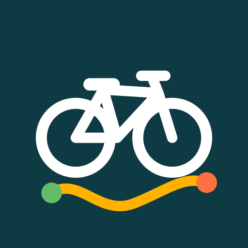

# 自転車ルートロガー

GPX のルートと経由地を地図に出して走り、走った道を GPS で記録する自転車用のアプリ。Google マップと航空写真に対応。走りながら写真を撮って、地図と写真の SNS 用の画像も作れます。

## ダウンロード

### [APK をダウンロード（v0.8.0・14.7 MB）](https://github.com/kijitora-no-hito/android-apps/releases/download/cycleroutelogger-v0.8.0/cycleroutelogger-0.8.0-release.apk)

| 項目 | 内容 |
| --- | --- |
| バージョン | 0.8.0（2026-10-13） |
| ファイル | `cycleroutelogger-0.8.0-release.apk`（15,434,180 バイト） |
| SHA-256 | `CE41797CE6BE1E5FEF160C5974B6C523ED5FFB513084A22A4EBED2B66D2A4E09` |
| 対応 Android | 7.0 以上 |
| 権限 | 位置情報（使用中のみ。「常に許可」は任意）、通知、カメラ（走行中の写真）、インターネット（地図・GPX の取得） |
| 価格 | 無料・広告なし・アプリ内課金なし・アカウント登録なし |

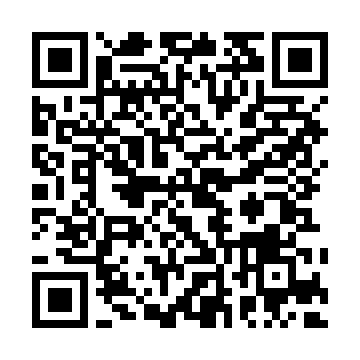 PC で見ている方へ: スマホでこの QR を読み取ると、このページが開きます。

## どんなアプリ？

### 2 つの走り方

- **フリーサイクリング**: ルートなしで走って、走った道を記録します。
- **ルートサイクリング**: 「ルートプラン」を選んで、ルートと経由地を見ながら走ります。ルートからの外れ、始点からの距離・残りの距離、**次の経由地**（名前・種類・ルート沿いの距離）を表示し、外れたときや経由地に近づいたときに知らせます。

### ルートプランと経由地

- 1 つのプランに **GPX のルートを何本でも**入れられます（1 日目・2 日目、往路・復路など）。並べ替え・色・表示の切り替え・標高グラフ。
- **経由地を地図で登録**: 地図を長押しして、種類（飲食店・休憩地点・観光地点・駐輪・宿泊・駅・トイレ・コンビニ・給水・その他）を選びます。ドラッグで移動、種類ごとの表示切り替え、ルート沿いの順の一覧（始点から何 km）。
- GPX の読み込みは、ファイルを選ぶか、他のアプリから「開く」「共有」で。GPX 1.0 / 1.1 のトラック・ルート・ウェイポイントに対応（ウェイポイントは経由地になります）。プランは GPX で書き出し・共有できます。
- **QR コード・URL からも読み込めます**: Google ドライブ・Dropbox・OneDrive・GitHub の共有リンクや https の URL。Google ドライブは共有設定を「リンクを知っている全員」にしてください（フォルダのリンクは非対応）。取り込む前に中身を確認できます。
- **ルートを描く**: 地図をタップして点を打つと、直線でつないだルートになります。点のドラッグ、線の途中に点を入れて分割、ハンドルで**ベジエ曲線**に。角・なめらか・対称の切り替え、全体をなめらかに、折り返し、元に戻す。描いたルートは何度でも曲線のまま編集し直せます（GPX には細かい点にして書き出します）。
- **場所名で検索**: ルートプラン・ルートを描く・走行画面の地図で、駅や公園などの名前から地点を探せます（検索ボタンを押したときだけ。結果から経由地に追加・目的地にする・点を打つ）。場所検索: Nominatim / © OpenStreetMap contributors。
- 地図と一覧の境目のつまみで地図の広さを変えられ、［全画面］で地図だけにもできます。プランとルートを描く画面の地図には［現在地へ］ボタン。

### 今向かいたい地点

- 経由地をタップ、または地図を長押しして［ここへ向かう］。地図の上に**方角の矢印と距離**（例: 北東 3.0 km、ルート沿い 4.1 km）と、現在地からの破線が出ます。画面の外なら端に矢印。着いたら知らせて、次の経由地へ進めます。

### 記録

- 画面を消しても記録を続けます（通知に経過時間と距離）。速度・距離・走行時間・平均・最高・獲得標高。止まっている間は自動で一時停止。
- 途中でアプリが落ちても、記録は端末に残り、続きから再開できます。
- 記録の一覧・詳細（速度で色分けした軌跡、標高グラフ）。詳細の地図は大きく（つまみで広さを変える・全画面）。
- **区間**: 1 km ごと・5 km ごとの走行時間・平均・最高速度・登り（一番速い区間・遅い区間に色）。
- **速度の分布**: 2 km/h ごとのヒストグラム（その速さで走った時間か距離）。棒をタップすると「14–16 km/h：4分49秒（全体の 30%）」のように表示。
- **まとめ**（0.7.0〜）: 記録の一覧から、全記録の総走行距離・総走行時間・回数・平均・走った日数・獲得標高・写真の数・**開拓したマス**（走ったことのある 1 km 四方のマス目の数）、最高速度やいちばん長い記録。期間（全期間・今年・今月・直近 30 日・任意）とフリー / ルートで絞れます。月ごとの距離・曜日 / 時間帯ごとの走行時間・速度の分布のグラフと、**全走行を重ねた地図**（記録ごとの色 / よく走った道ほど濃く、軌跡をタップでその記録へ、写真の位置）。**開拓したマスも地図に表示**でき、期間内で初めて走ったマスは橙色で出します（記録の詳細でも、その記録で初めて走ったマスを表示）。
- **走り終えたら、記録を［ルートとして保存］（点の間引き・止まっていた間を除く）や［GPX で書き出す］［共有］**。フリー・ルートどちらの走り方でも。
- バックグラウンドでも記録が続きます。始められなかったときや止まったときは理由と対処を表示します。電池の使用量を「制限なし」にすると長時間でも止まりにくくなります。

### 写真と SNS 用の画像

- 走行画面の［写真］ボタンでアプリのカメラが開き、撮った写真は**フォトライブラリ**（Pictures/自転車ルートロガー）に保存されます（撮影日時と位置を写真に記録。位置を入れない設定も）。他のカメラアプリで撮った写真も、記録に追加できます。
- 写真は撮った時刻と位置で記録に紐づき、地図に縮小版で出ます。
- **SNS 用の画像**: 走ったルートの地図・写真（最大 6 枚、地図の撮影位置に番号）・距離や時間を 1 枚にまとめます。正方形・縦長・横長から選び、保存・共有（X・Instagram・LINE など）。**記録中でも**走行画面の共有ボタンから、ここまでの記録で作れます（記録は続きます）。
- 地図は標準・航空写真・航空写真＋地名・地形を切り替えられます。走行中は数字だけを大きく出す「大きな表示」も。

<table>
<tr>
<td align="center">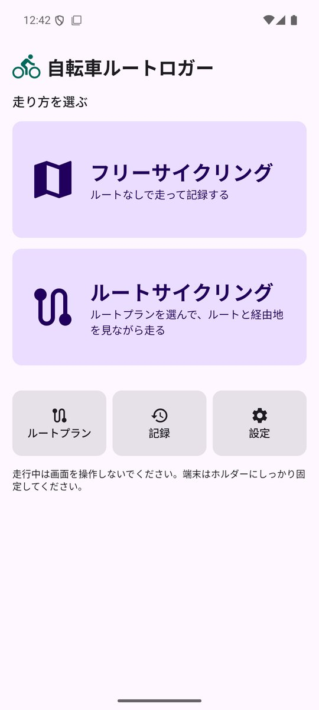 ホーム（走り方を選ぶ）</td>
<td align="center">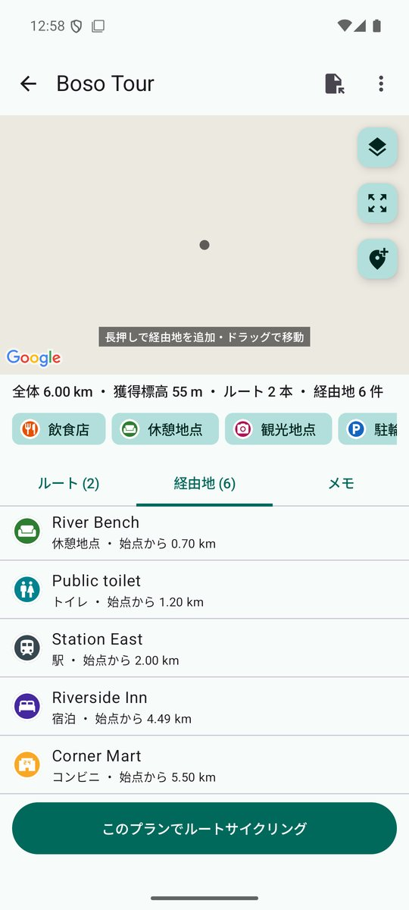 ルートプランと経由地</td>
<td align="center">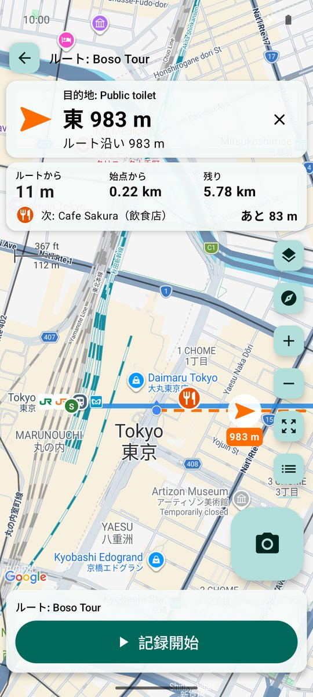 目的地の方角と距離</td>
</tr>
<tr>
<td align="center">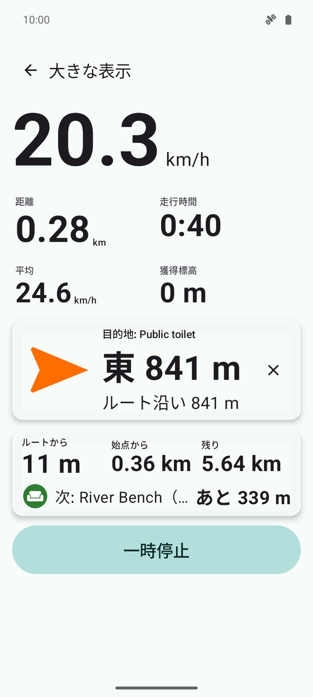 大きな表示</td>
<td align="center">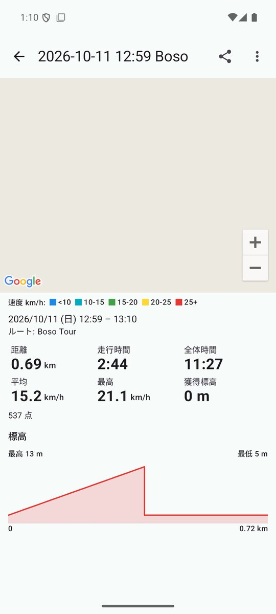 記録の詳細</td>
<td align="center">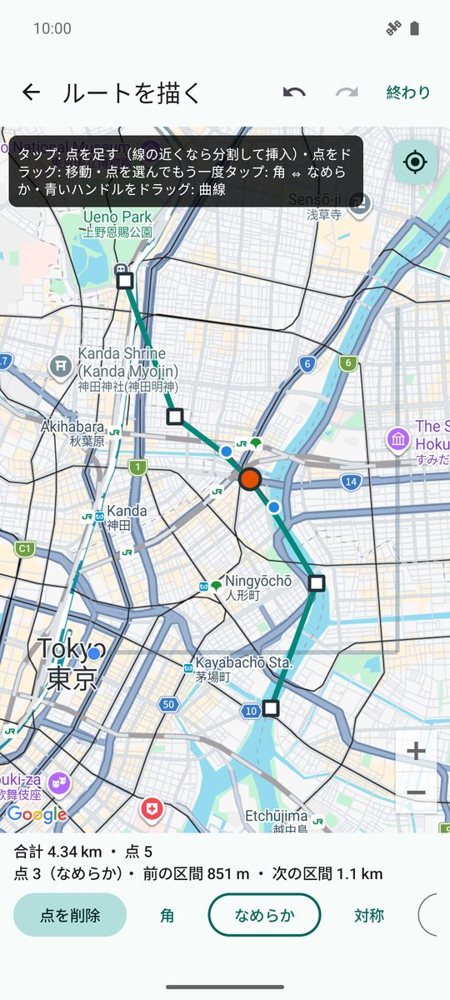 ルートを描く（ベジエ曲線）</td>
</tr>
<tr>
<td align="center">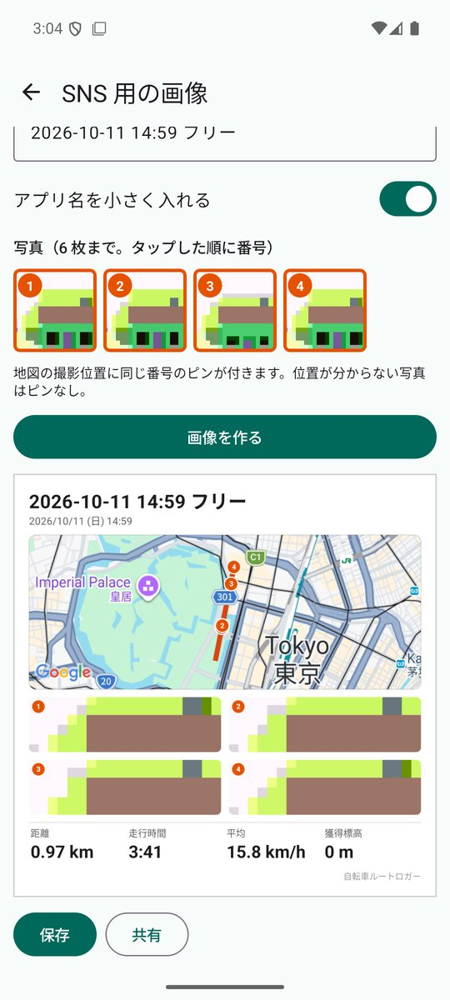 SNS 用の画像</td>
<td align="center">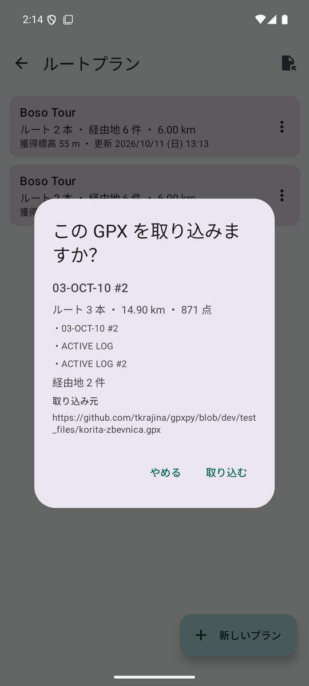 URL・QR から GPX を読み込む</td>
<td align="center">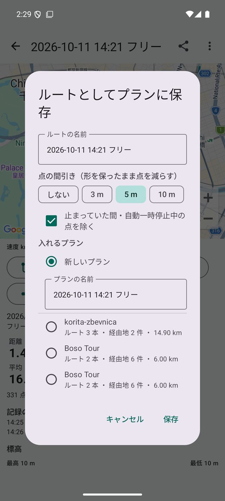 記録をルートとして保存</td>
</tr>
<tr>
<td align="center">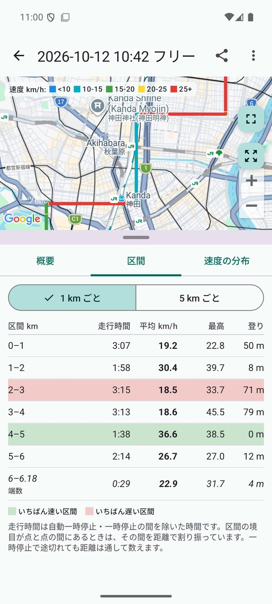 1 km ごとの区間</td>
<td align="center">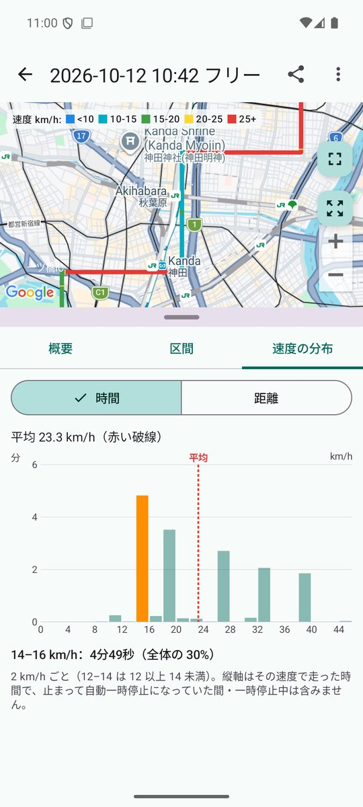 速度の分布（2 km/h ごと）</td>
<td align="center">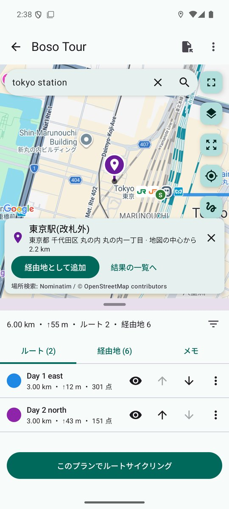 場所名で検索</td>
</tr>
<tr>
<td align="center">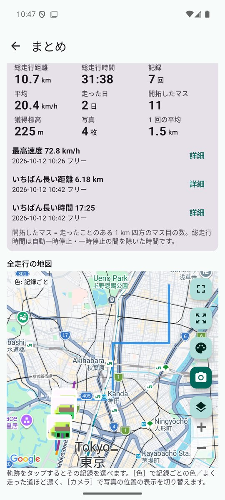 まとめ（統計と全走行の地図）</td>
<td align="center">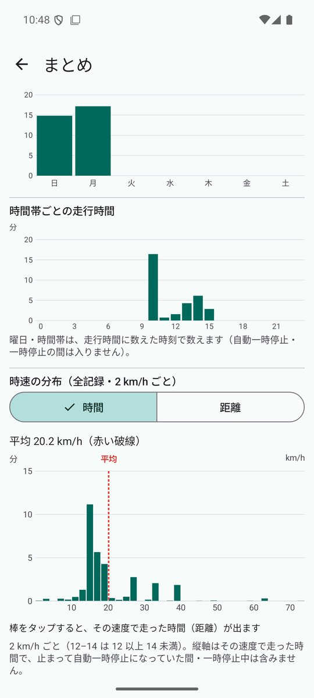 まとめ（グラフ）</td>
<td align="center">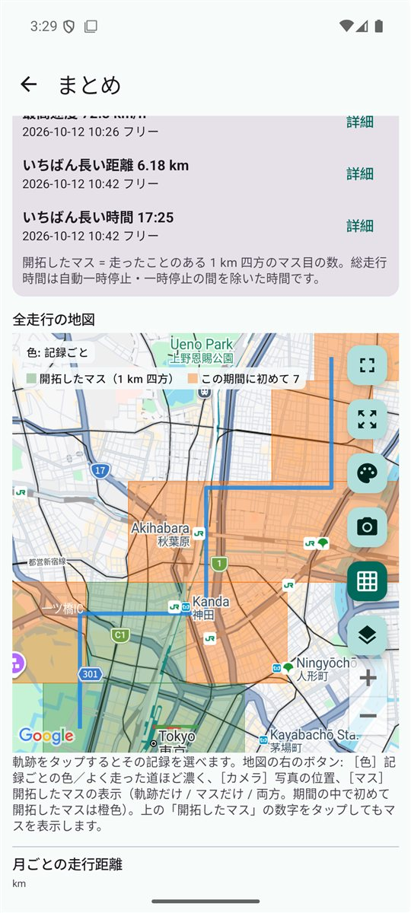 開拓したマス</td>
</tr>
</table>

（スクリーンショットはエミュレータのものです。写真はエミュレータの仮のカメラ映像です。）

## 安全のために

- **走行中に画面を見続けたり、操作したりしないでください。** 操作は止まってから。
- 端末はホルダーにしっかり固定してください。
- ルート・距離・速度・方角は GPS による目安です。道路の状況と交通ルールに従ってください。

## データについて

- 記録・ルートプラン・経由地は端末の中だけに保存し、送信しません。広告・アクセス解析はありません。
- 通信するのは、地図の取得、あなたが指定した URL（QR コードを含む）から GPX を取得するとき、場所名の検索で検索ボタンを押したとき（検索語と地図のおおよその範囲を Nominatim に送ります）、更新の確認だけです。QR コードの読み取りには Google Play 開発者サービスのスキャナを使います。
- 撮った写真はフォトライブラリに保存されます。SNS 用の画像は、あなたが共有したときだけ外に出ます。
- 更新の確認のため、GitHub から公開の版の一覧を取得します（6 時間に 1 回まで。設定で OFF にすると通信しません）。
- 地図の表示に Google マップを使います（Google のプライバシーポリシーが適用されます）。
- 画面を消して記録している間も、位置の権限は「アプリの使用中のみ」で動きます。「常に許可」にすると、アプリがシステムに止められたときも記録中なら自動で再開します（任意）。

## インストール方法

1. このページをスマホのブラウザで開き、上の「APK をダウンロード」を押します。
2. ダウンロードした APK を開きます。初回は「提供元不明のアプリ」のインストールを許可するよう求められるので、使っているブラウザ（またはファイルアプリ）に許可してください。
3. Google Play プロテクトが警告を出すことがあります。ストアを通さない APK では一般的に出る表示です。心配なときは上の SHA-256 と一致するか確かめてください。
4. **アンインストールすると、端末内の記録とプランは消えます。** 先に設定の「バックアップ」で書き出しておいてください。

詳しい手順は[トップページ](../)の「インストール方法（共通）」にもあります。

### 更新について

- 自動更新はありません。0.4.0 からは、新しい版が出るとホーム画面に「新しい版があります」と出ます（［ダウンロード］で APK を落として上書きインストール。記録とプランは残ります）。
- それより前の版を使っている方は、このページから同じ手順で入れ直してください。
- このアプリは GitHub でのみ配布しています。

## プライバシーポリシー

[自転車ルートロガー プライバシーポリシー](https://kijitora-no-hito.github.io/android-apps/cycle_route_logger/privacy-policy.html)

---

[← アプリ一覧に戻る](../)
