
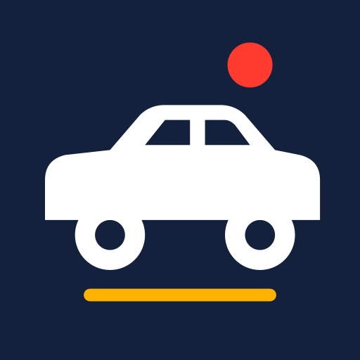

# ドライブロガー

車での走行を GPS で記録するアプリ。必要なときだけドラレコのように録画したり、写真を撮ったり、車を停めて歩いたりと、1 回のドライブの中で自由に組み合わせられます。ナビ機能はありません。

## ダウンロード

### [APK をダウンロード（v0.4.1・16.7 MB）](https://github.com/kijitora-no-hito/android-apps/releases/download/drivelogger-v0.4.1/drivelogger-0.4.1-release.apk)

| 項目 | 内容 |
| --- | --- |
| バージョン | 0.4.1（2026-10-13） |
| ファイル | `drivelogger-0.4.1-release.apk`（17,549,053 バイト） |
| SHA-256 | `76BDBA2AD5D58BCAF58509BBB2D0996FA3C1DE26CDC74625DB954FDE5B73DD03` |
| 対応 Android | 7.0 以上 |
| 権限 | 位置情報（使用中のみ。「常に許可」は任意）、カメラ（録画・写真）、マイク（音声を録るときだけ・既定 OFF）、通知、インターネット（地図・更新の確認） |
| 価格 | 無料・広告なし・アプリ内課金なし・アカウント登録なし |

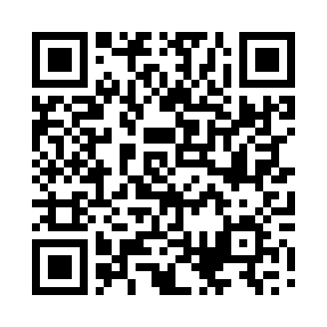 PC で見ている方へ: スマホでこの QR を読み取ると、このページが開きます。

## どんなアプリ？

### 走行の記録（基本）

- ［開始］で GPS の記録を始めます。走行画面は地図と大きな速度、走行距離・経過時間・停車時間。
- 画面を消しても、アプリを裏に回しても記録を続けます（通知に表示）。途中でアプリが落ちても、記録は端末に残ります。
- **GPS と加速度センサーの組み合わせ**: GPS の位置・速度を、加速度とジャイロで補って軌跡と速度のばらつきを減らします。ビル街や短いトンネルで GPS が途切れても、しばらくは推測で補います（設定で OFF にできます。元の GPS の値も残します）。
- **停車中は測位を止めます**: 止まっていると判断したら GPS を止めて電池を節約し、止まった位置にいるものとして記録します。動き出すとすぐに再開します。
- ドライブごとに、地図の軌跡（速度で色分け）・距離・時間・平均/最高速度・停車時間・獲得標高、5 km / 10 km ごとの区間、速度の分布（10 km/h ごと）。GPX で書き出し・共有。
- **タイムライン**: 録画した区間・写真・駐車・停車・衝撃を時刻の順に。タップでその場面の動画・写真・地図へ。

### 写真と駐車（寄り道）

- 走行画面の［写真］でいつでも撮れます。**録画中も録画を止めずに**撮れます。写真はフォトライブラリ（Pictures/ドライブロガー）に保存し、撮った時刻と位置でドライブに紐づきます（地図にも表示）。他のカメラアプリで撮った写真も追加できます。
- **［駐車する］**: 停車中に押すと、GPS の記録（と録画）を止めて駐車位置を記録します（地図に P）。歩いて写真を撮り（撮るたびにその場で 1 回だけ位置を測ります）、［ドライブを再開］で続きを走れます。車までの方角と距離も確かめられます。何度でも駐車・再開できます。歩いた道の記録は設定で選べます（既定はしない）。
- **SNS 用の画像**: 地図・写真・距離や時間を 1 枚にまとめます（記録中でも作れます。最高速度を入れない選択も）。

### 録画（オプション）

- 開始のときに［記録だけ］か［記録＋録画］を選べ、走行中にも［録画 ON / OFF］で切り替えられます（記録は途切れません）。
- 録画中は**横画面**が既定です（設定で端末の向きに従うことも）。
- **表示はあとから重ねる**（既定）: 録画は表示なしのきれいな映像で保存し、日時・速度・緯度経度・方位・メーター・地図などの表示は、再生やギャラリー・SNS への書き出しのときに GPS の記録から重ねます。書き出すたびに入れる項目を選べ、入れない項目は**最初から描きません**（黒い帯で覆いません）。録画のときに焼き込む方式も設定で選べます。画面の地図（Google マップ）は映像に入れません（地図は国土地理院の地図を使います）。
- **ループ録画**: 1 / 3 / 5 分ごとのファイルに分けて録り続け、容量の上限（2〜16 GB）を超えたら、保護していない古いものから消します。
- **保護**: 衝撃を感じたとき（感度 低・中・高）や［保護］ボタンで、その前後の動画を消さないように守ります。
- **地図も入れられる**（オプション）: 動画の隅に国土地理院の地図（標準・淡色・写真）と走った軌跡・現在地を入れます（出典も一緒に入ります）。大きさ・位置・ズーム・向きを選べます。
- **メーター表示**（オプション）: 速度計（針）・コンパス・G メーター。画面と動画でそれぞれ「文字 / メーター」を選べます。
- 解像度 1080p（既定）/ 720p。音声の録音は既定 OFF（設定で ON）。
- 動画の再生では、再生位置に合わせて地図の位置と速度も表示。ギャラリー（Movies/ドライブロガー）への書き出し・共有。

### SNS 用に書き出す

- 動画の範囲を切り出し、X・Instagram リール・YouTube・LINE の長さや大きさの目安に合わせて書き出します（続けて録ったファイルはつなげられます。Instagram は縦 9:16 に切り抜けます）。
- **決めた速度を超えた場面だけ、速度の表示を出さないようにできます**（実際より低い数字を出すことはしません）。緯度経度・地図も外せます。元の動画と記録は変わりません。（0.3.0 以前の焼き込み方式で録った動画は、表示を「---」の帯で覆います。）
- 書き出した動画は共有画面から各 SNS のアプリに渡します（アプリが直接投稿することはありません）。ギャラリーにも保存できます。

### まとめ

- 全記録の統計（総走行距離・総走行時間・平均/最高速度・いちばん長い旅・走った日数・録画した時間・開拓したマス＝走ったことのある 1 km 四方の数）を期間ごとに（全期間・今年・今月・直近 30 日・任意）。
- 月ごとの走行距離、曜日・時間帯ごとの走行時間、全記録の速度の分布のグラフ。
- **全走行の地図**: 期間内のすべての軌跡を 1 枚の地図に。どこを走ったかが分かります。**開拓したマス**（1 km 四方）も地図に表示でき、期間内で初めて走ったマスは色を変えて出します。写真の位置も表示できます。
- ドライブの詳細とまとめの地図は、つまみで広さを変えられ、全画面にもできます。

<table>
<tr>
<td align="center">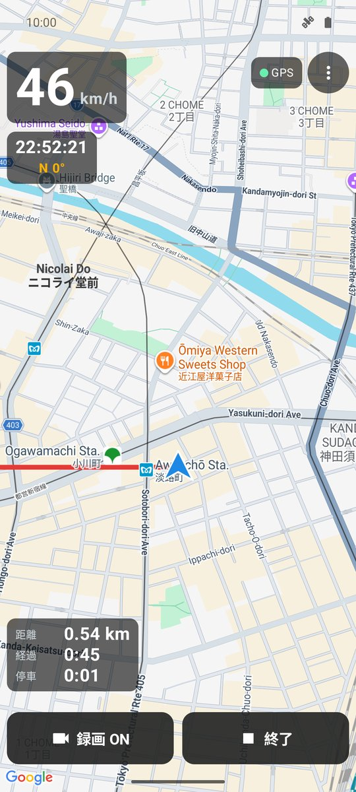 記録中（地図と速度）</td>
<td align="center">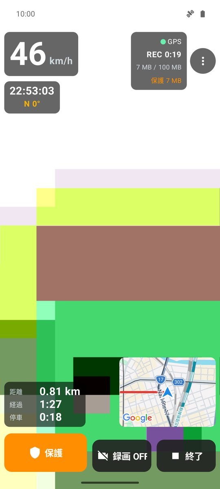 録画中（ドラレコ）</td>
<td align="center">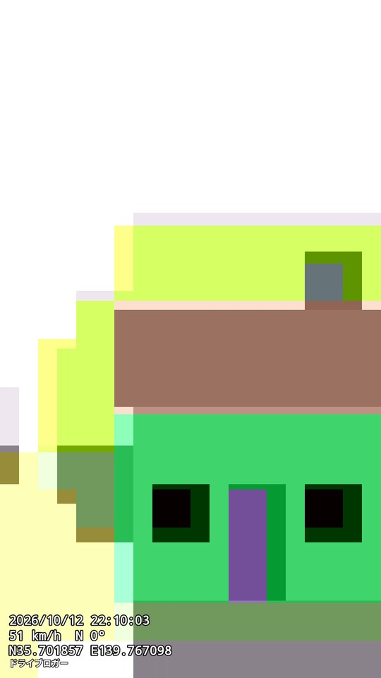 表示を重ねた動画</td>
</tr>
<tr>
<td align="center">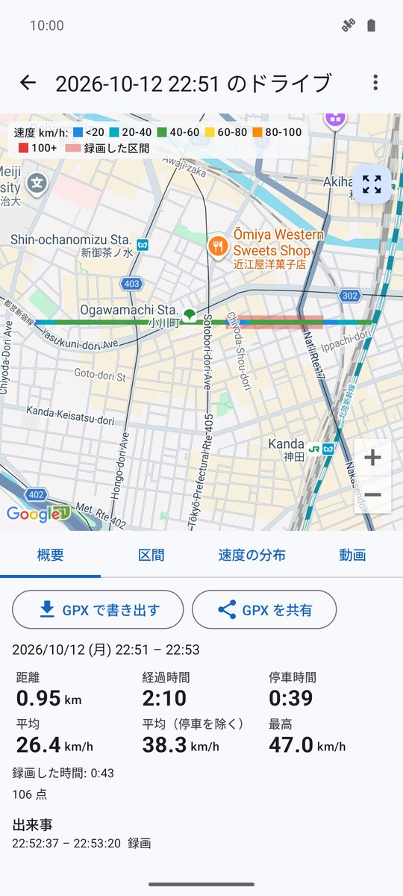 記録の詳細</td>
<td align="center">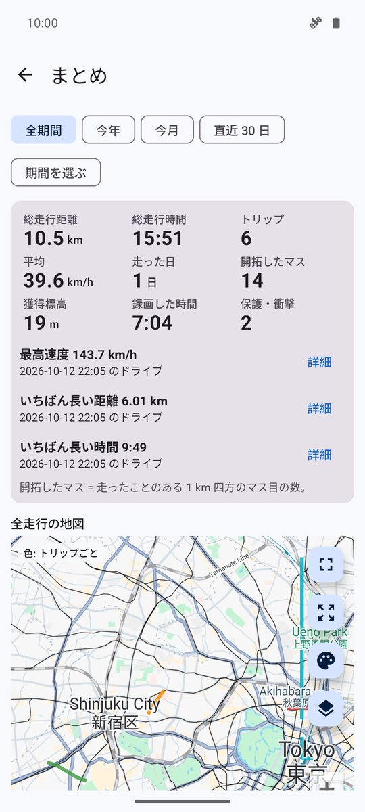 まとめ</td>
<td align="center">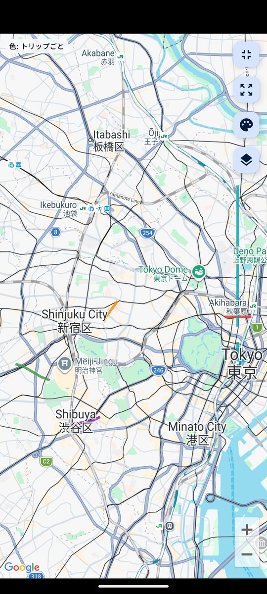 全走行の地図</td>
</tr>
<tr>
<td align="center">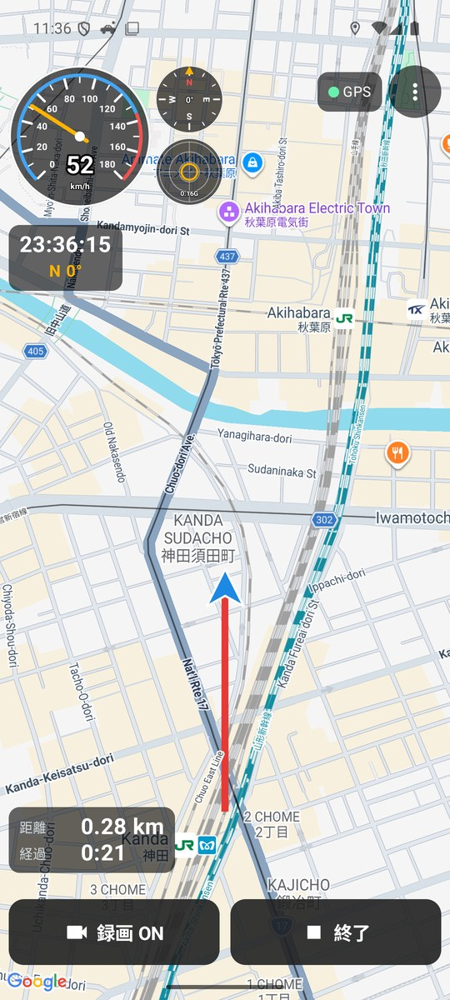 メーター表示</td>
<td align="center">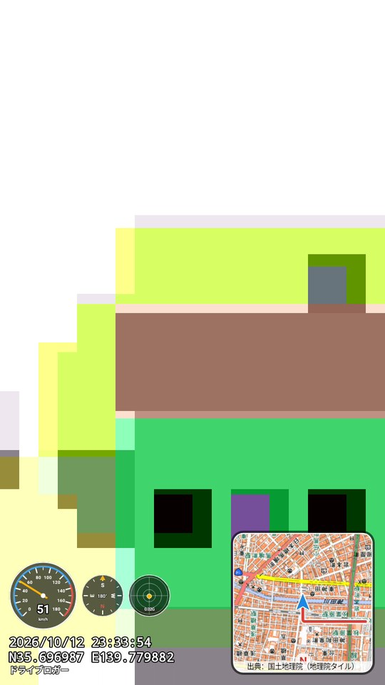 地図とメーターを重ねた動画</td>
<td align="center">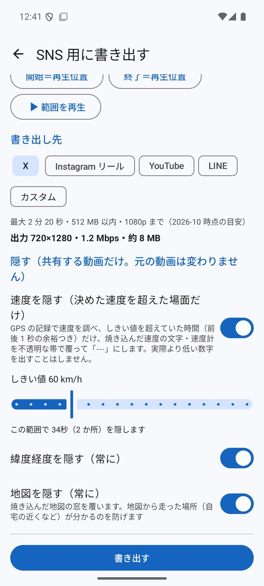 SNS 用に書き出す</td>
</tr>
<tr>
<td align="center">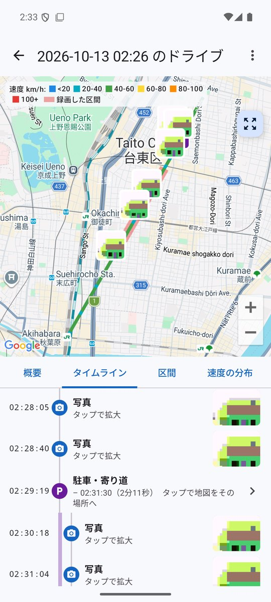 タイムライン（駐車中の写真）</td>
<td align="center">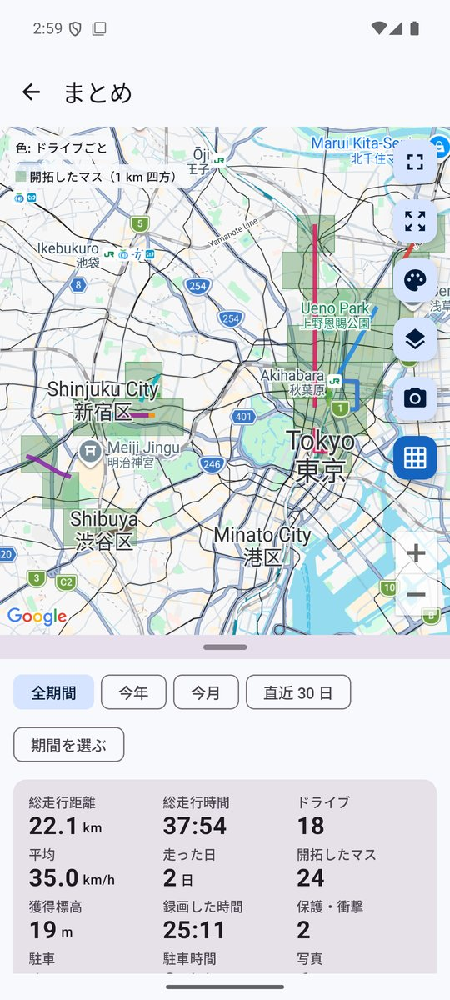 開拓したマスと全走行</td>
<td></td>
</tr>
<tr>
<td align="center" colspan="3">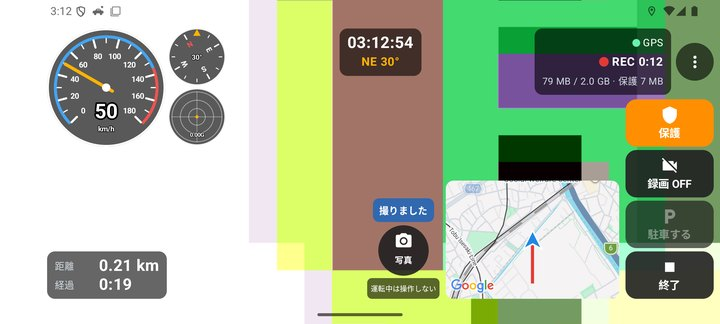 横向きの録画中に写真を撮影</td>
</tr>
</table>

（スクリーンショットはエミュレータのものです。カメラの映像はエミュレータの仮の映像です。）

## 安全とマナー

- **運転中はアプリを操作しないでください。画面を注視しないでください。** 操作は停車中に。
- 端末はしっかり固定し、視界や運転操作の妨げにならない位置に設置してください。
- 長時間の録画では端末が熱くなります。直射日光の当たる場所に置かないでください（熱くなりすぎると録画を止めます）。
- 録画には他人や他の車のナンバー、歩行者などが写ります。動画を公開・共有するときは、プライバシーや肖像に配慮してください。音声を録るときは同乗者に伝えてください。
- 速度・距離は GPS による目安です。車の速度計の代わりにはなりません。

## データについて

- 位置の記録と動画は端末の中だけに保存し、送信しません。広告・アクセス解析はありません。
- 通信は、地図の表示（Google マップ）、更新の確認（GitHub の公開の版一覧、6 時間に 1 回まで・設定で OFF）、動画に地図を入れるときの地理院タイルの取得（国土地理院のサーバー）だけです。
- 撮った写真はフォトライブラリに保存されます（撮影日時と位置を写真に記録。位置を入れない設定も）。
- 動画に焼き込む地図: 出典：国土地理院（地理院タイル）。

## インストール方法

1. このページをスマホのブラウザで開き、上の「APK をダウンロード」を押します。
2. ダウンロードした APK を開きます。初回は「提供元不明のアプリ」のインストールを許可するよう求められるので、使っているブラウザ（またはファイルアプリ）に許可してください。
3. Google Play プロテクトが警告を出すことがあります。ストアを通さない APK では一般的に出る表示です。心配なときは上の SHA-256 と一致するか確かめてください。
4. **アンインストールすると、端末内の記録と（書き出していない）動画は消えます。**

詳しい手順は[トップページ](../)の「インストール方法（共通）」にもあります。

### 更新について

- 新しい版が出ると、アプリの画面でお知らせします（［ダウンロード］で APK を落として上書きインストール。記録は残ります）。設定で OFF にできます。
- このアプリは GitHub でのみ配布しています。

## プライバシーポリシー

[ドライブロガー プライバシーポリシー](https://kijitora-no-hito.github.io/android-apps/drive_logger/privacy-policy.html)

---

[← アプリ一覧に戻る](../)
