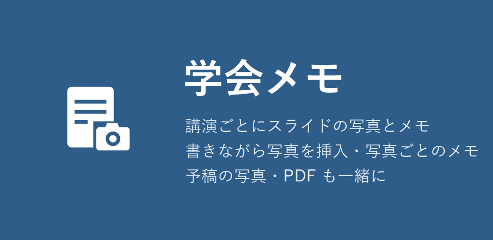

# 学会メモ

学会の聴講中に、講演ごとにスライドの写真とメモを残すアプリ。文章を書きながらその場に写真を挿入でき、写真ごとにもメモを付けられます。予稿の写真・PDF も一緒に。通信なし・権限はカメラだけ。

## ダウンロード

> **プレビュー版です。** 実機での確認がまだ十分ではありません。不具合があれば [Issues](https://github.com/kijitora-no-hito/android-apps/issues) へお知らせください。

### [APK をダウンロード（v0.2.0・12.7 MB）](https://github.com/kijitora-no-hito/android-apps/releases/download/gakkaimemo-v0.2.0/gakkaimemo-0.2.0-release.apk)

| 項目 | 内容 |
| --- | --- |
| バージョン | 0.2.0（2026-11-25・プレビュー） |
| ファイル | `gakkaimemo-0.2.0-release.apk`（13,277,183 バイト） |
| SHA-256 | `EBA324804F6EB4AB8FEE05D614CF217D9F812FBDFF01741E73CBD2ED73828A0D` |
| 対応 Android | 7.0 以上 |
| 権限 | カメラ（スライドなどの撮影）だけ。インターネットにはつながりません |
| 価格 | 無料・広告なし・アプリ内課金なし・アカウント登録なし |

 PC で見ている方へ: スマホでこの QR を読み取ると、このページが開きます。

## どんなアプリ？

### 学会・セッション・講演

- 「学会」（学会名・開催地）の中に「聴講セッション」（セッション名・日付・会場）をいくつでも作り、セッションの中に講演を並べます。
- 学会の画面ではセッションを日付順に並べ、会期（最初の日〜最後の日）を表示します。セッションは別の学会へ移すこともできます。
- 講演にはタイトルと講演者を入力できます。入力する時間がないときは、**タイトルのスライドやプログラムの写真で代用**できます。
- 講演の並べ替え・削除ができます。

### 予稿

- 予稿の**写真**（撮影・端末の画像から選ぶ）と **PDF** を講演に登録できます。PDF はアプリの中で表示（拡大もできます）、ほかのアプリで開くこともできます。

### 聴講中のノート

- 文章を書きながら、下の［撮影］［画像］を押すと、**カーソルの位置に写真を挿入**します。写真のあとからそのまま続きを書けます。
- ［撮影］は閉じるまで**続けて何枚でも**撮れます（ズーム・タップでピント合わせ・**音量キーでもシャッター**）。
- 写真ごとに**その写真へのメモ**を付けられます。写真はタップで全画面表示（拡大・左右送り）。
- 入力は自動で保存されます。

### シャッター音について

- アプリ内のカメラは**シャッター音を鳴らしません**。撮った合図は画面の白いフラッシュで表示します。
- 機種によって音が鳴ってしまう場合は、設定の「撮影方式」を「確実に無音」（プレビューの画像から取り込む。画質は少し下がります）にしてください。
- **撮影が許可されている講演でだけ使ってください。** 撮影や写真の共有を禁じる学会・講演者の決まりに従ってください。

### 検索・書き出し・バックアップ

- 講演タイトル・講演者・メモ・写真のメモ・セッション名をまとめて検索できます。
- 講演ごとに **Markdown のメモ＋写真＋予稿の ZIP** に書き出せます。メモの文章だけをほかのアプリへ共有することもできます。
- 全体を ZIP にバックアップして、機種変更のときに復元できます。

### 写真の保存先

- 写真は**アプリの中だけ**に保存し、端末のギャラリー（写真アプリ）には出しません。端末の画像を取り込むときは写し直すので、位置情報などは残りません。

## インストール方法

1. このページをスマホのブラウザで開き、上の「APK をダウンロード」を押します。
2. ダウンロードした APK を開きます。初回は「提供元不明のアプリ」のインストールを許可するよう求められるので、使っているブラウザ（またはファイルアプリ）に許可してください。
3. Google Play プロテクトが警告を出すことがあります。ストアを通さない APK では一般的に出る表示です。心配なときは上の SHA-256 と一致するか確かめてください。
4. **アンインストールすると、端末内のメモと写真は消えます。** 先に「設定 → バックアップ」で控えを取ってください。

詳しい手順は[トップページ](../)の「インストール方法（共通）」にもあります。

### 更新について

- 自動更新はありません。新しい版が出たら、このページから同じ手順で入れ直してください（上書きインストールになり、記録は残ります）。
- 0.1.0 から 0.2.0 へ上書きすると、それまでのセッションは学会名ごとにまとめて学会の下へ移ります（学会名が空のものは「学会名なし」）。
- このアプリは GitHub でのみ配布しています。

## プライバシーポリシー

[学会メモ プライバシーポリシー](https://kijitora-no-hito.github.io/android-apps/gakkai_memo/privacy-policy.html)

---

[← アプリ一覧に戻る](../)
