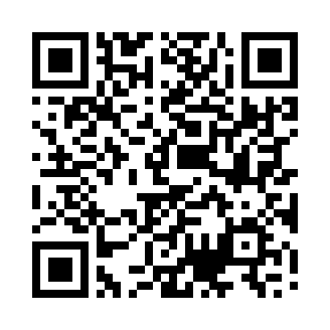
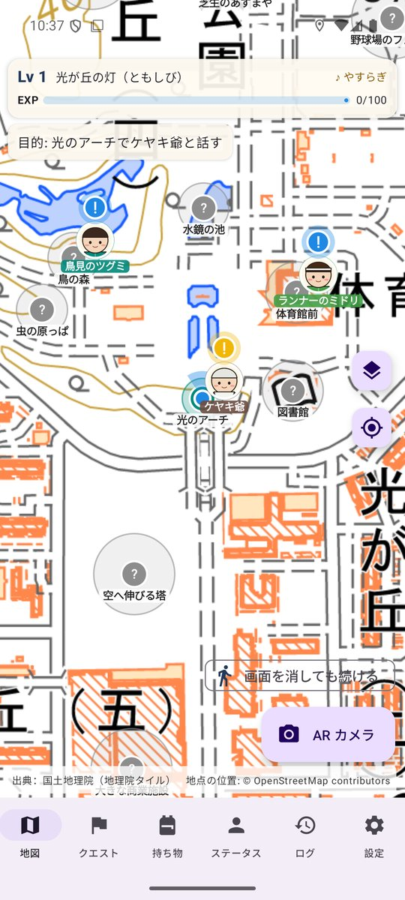
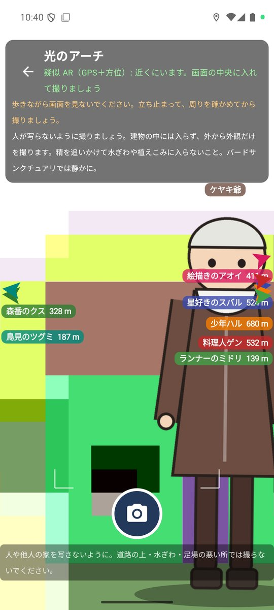
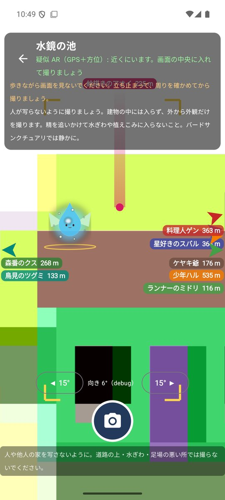
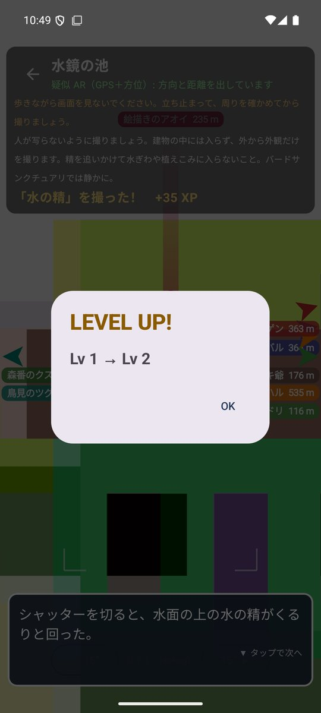
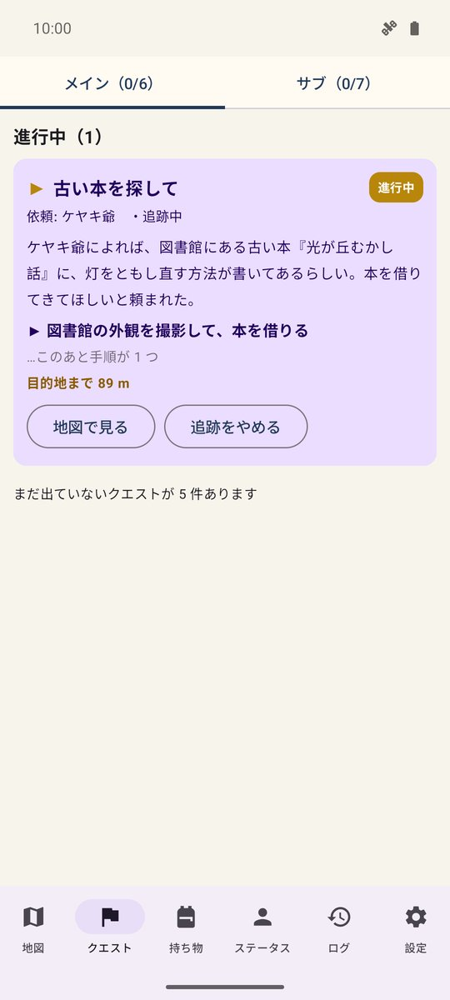
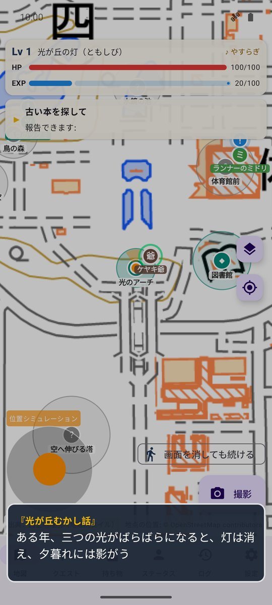

# ジオクエスト（開発中・仮名）

> **⚠ 開発中の版です。** いまはゲームの土台と、光が丘公園のシナリオ・短いデモだけです。名前・内容・画面は今後大きく変わります。
> セーブデータは今後の版で引き継げなくなることがあります。

現実の街を歩いて、カメラの向こうにいる人や精霊を探して撮る、GPS の位置ゲームです。

## ダウンロード

### [APK をダウンロード（v0.4.0-dev・16.4 MB）](https://github.com/kijitora-no-hito/android-apps/releases/download/geoquest-v0.4.0-dev/geoquest-0.4.0-dev-release.apk)

| 項目 | 内容 |
| --- | --- |
| バージョン | 0.4.0-dev（2026-10-11・開発中） |
| ファイル | `geoquest-0.4.0-dev-release.apk`（17,168,874 バイト） |
| SHA-256 | `83C96F48CD1E4130F05FCF1E279D7040FFDAA6DBBFCB71657EDEC4D4FA1A38FA` |
| 対応 Android | 7.0 以上（地面に立たせる AR は ARCore 対応端末のみ） |
| 権限 | 位置情報、身体活動（歩数）、カメラ、通知、インターネット（地図の画像） |
| 価格 | 無料・広告なし・アプリ内課金なし・アカウント登録なし |

 PC で見ている方へ: スマホでこの QR を読み取ると、このページが開きます。

## どんなゲーム？

- **実際の場所へ行く**と、その場所に人（NPC）や精霊が立っています。**AR カメラ**で見ると、景色の中に立ち絵が現れます。
- **カメラで撮るとイベントが進みます。** 頼まれた物の場所を撮る、隠れた精霊を見つけて撮る、NPC を撮って話しかける——。撮った写真は立ち絵が写り込んだ記念写真として残ります。
- 遠くにいるときは「あの方向・何 m 先」を示し、場所に着くと、ARCore 対応端末では**地面を認識して足元に立ちます**（非対応の端末でも、GPS と方位の AR で遊べます）。
- **歩いたり撮ったりすると経験値**が入り、Lv が上がります（歩いた距離は徒歩の速さのときだけ数えます）。
- **場所に応じた BGM** が流れます（曲と効果音はアプリの中で合成したもの）。
- 冒険は「シナリオパック」で作られていて、アプリの作成モードや PC のエディタで、自分の冒険を作れます。

### シナリオ「光が丘の灯（ともしび）」— 練馬区・光が丘公園

むかし「光の丘」と呼ばれた丘には、灯がともっていたという。その灯をつくっていた光の精たちが、公園じゅうに散らばってしまった。公園の入口で出会ったケヤキ爺は、図書館にある古い本に、灯をともし直す方法が書いてあるはずだと言う——。

- 公園の入口・図書館・観賞池・くすのき広場・ピラミッド・大芝生など、**実際の場所を巡る**メインクエスト 6 つと、公園の人たちのサブクエスト 7 つ。
- 依頼を受けられる人の頭上には**「！」**（メインは金、サブは青）、報告できるときは**「？」**。目的地には旗が立ち、画面の外なら端に方向と距離が出ます。
- 例: 入口のケヤキ爺に頼まれて図書館へ。**外観の写真を撮ると本を借りたことになり**、本を手に入れてケヤキ爺に渡す。池に隠れた水の精を AR カメラで見つけて撮る。
- **建物の中には入りません**（外観の写真で済みます）。精を追いかけて水ぎわや植えこみに入らないでください。写真に人が写らないように。バードサンクチュアリでは静かに。
- 出発は光が丘駅前。遠くにいても選べます（地図で場所を見られます）。

### デモ「はじまりの小さな冒険」

冒険を始めた場所のまわり 50〜350 m に、宿・泉・古木・宝箱・野原・塔・祠の 7 か所が現れ、精霊を探して撮る短い冒険ができます。どこでも遊べますが、場所が道路や私有地にかかることがあります（その場所へは行かないでください）。

<table>
<tr>
<td align="center"> 地図（NPC と「！」）</td>
<td align="center"> AR カメラ: 入口のケヤキ爺</td>
<td align="center"> 池に隠れた水の精</td>
</tr>
<tr>
<td align="center"> 撮るとクエストが進む</td>
<td align="center"> クエスト一覧</td>
<td align="center"> 本の中身（物語）</td>
</tr>
</table>

（スクリーンショットはエミュレータの仮のカメラ映像です。）

## 安全のために

- **歩きながら画面を見ないでください。** AR カメラは、立ち止まって周りを確かめてから使ってください。
- **道路に飛び出さない・私有地や立ち入り禁止の場所に入らない。** 地図上の場所がそういう所にかかっていたら、行かないでください。
- 車・自転車など、徒歩より速い移動中は撮影でイベントが進まず、歩いた距離の経験値も入りません。
- 夜間や人通りの少ない場所、天候の悪いときは無理をしないでください。

## データについて

- 位置・写真・ゲームの進行は端末の中だけに保存し、送信しません。通信は地図の画像の取得だけです。
- 対応端末では、地面の認識に Google Play 開発者サービス（AR）（ARCore）を使います（位置を Google に送る機能は使っていません）。設定で「疑似 AR だけ」にもできます。
- 出典：国土地理院（地理院タイル）。光が丘公園のシナリオの地点の位置: © OpenStreetMap contributors（ODbL）。このアプリは国土地理院・東京都・練馬区が作成・承認したものではありません。

## インストール方法

1. このページをスマホのブラウザで開き、上の「APK をダウンロード」を押します。
2. ダウンロードした APK を開きます。初回は「提供元不明のアプリ」のインストールを許可するよう求められるので、使っているブラウザ（またはファイルアプリ）に許可してください。
3. Google Play プロテクトが警告を出すことがあります。ストアを通さない APK では一般的に出る表示です。心配なときは上の SHA-256 と一致するか確かめてください。
4. **アンインストールすると、端末内の記録・写真・作成したパックは消えます。**

詳しい手順は[トップページ](../)の「インストール方法（共通）」にもあります。

## プライバシーポリシー

[ジオクエスト プライバシーポリシー](https://kijitora-no-hito.github.io/android-apps/geo_quest/privacy-policy.html)

---

[← アプリ一覧に戻る](../)
