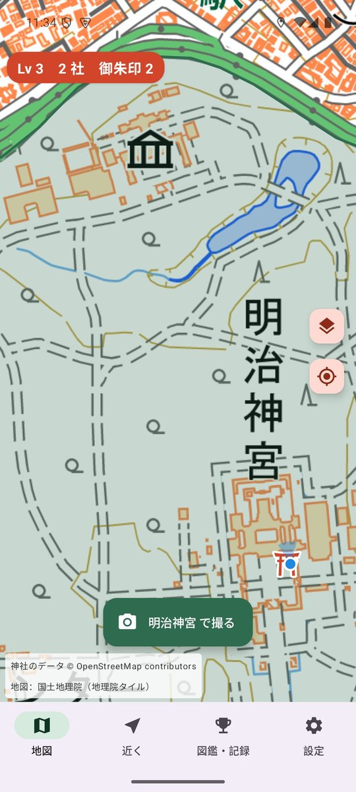
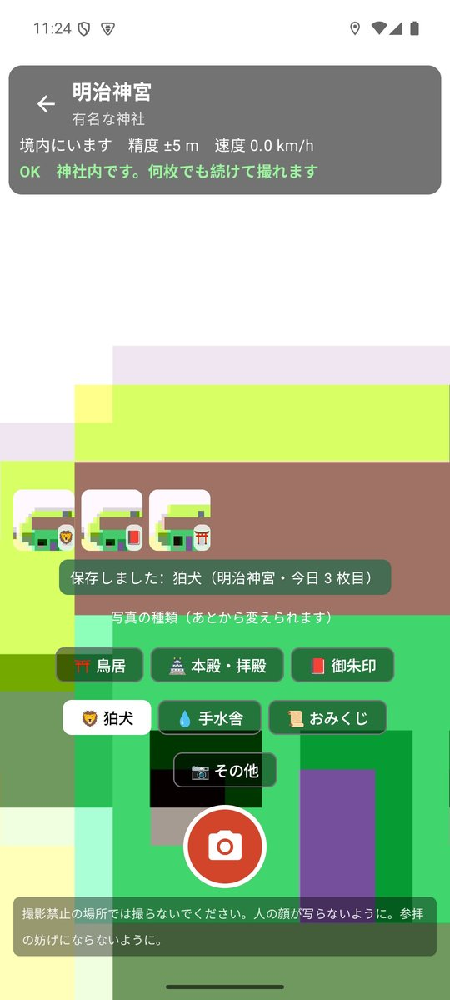
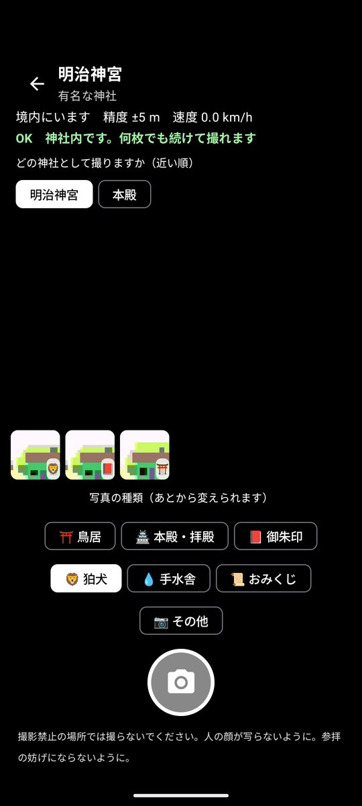
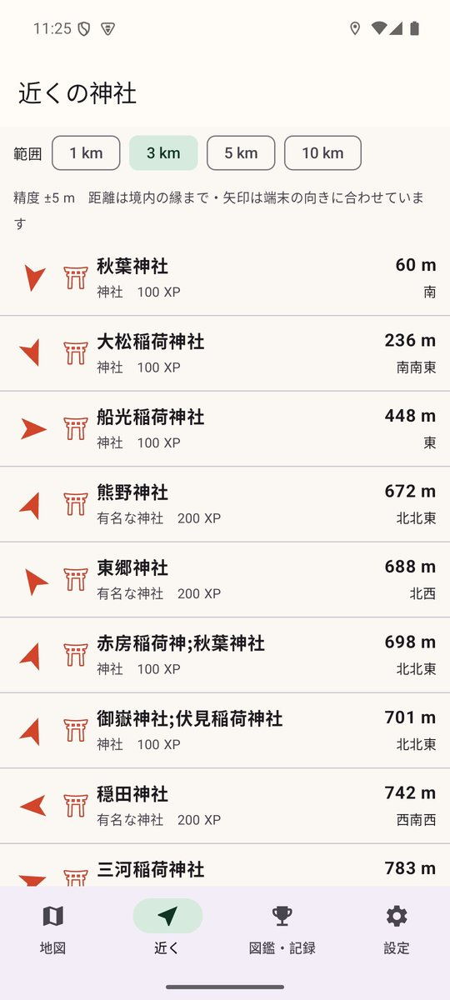
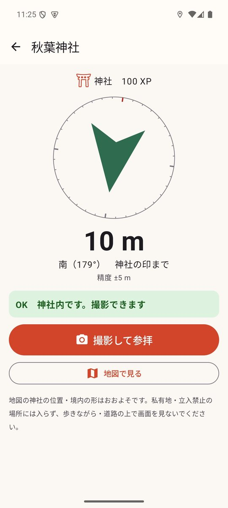
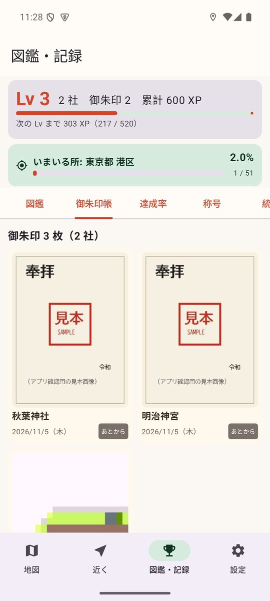
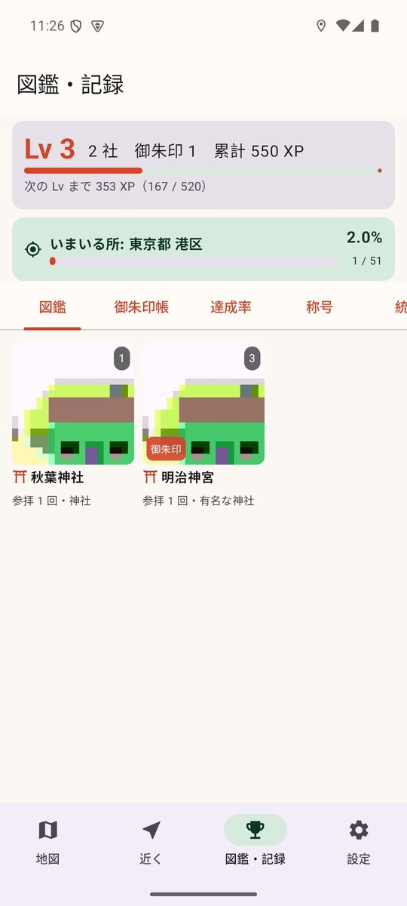
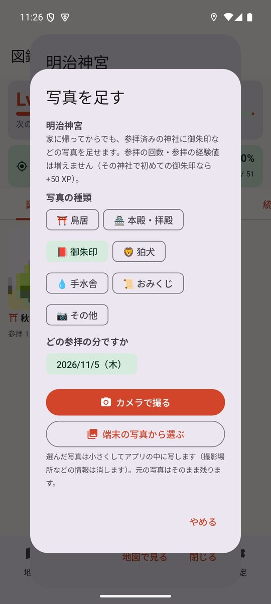
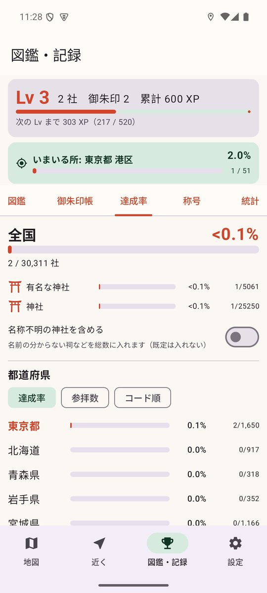
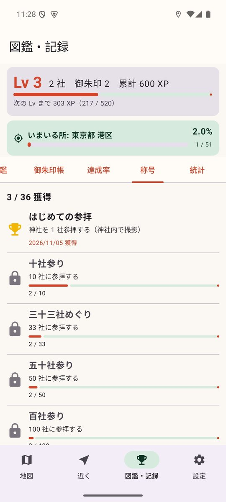

# 神社めぐり

全国の神社を訪ねて、参拝の記録と御朱印の写真を集める位置ゲーム。神社の境内で写真を撮ると参拝の記録になり、経験値がたまって Lv が上がります。

## ダウンロード

### [APK をダウンロード（v0.1.0・14.1 MB）](https://github.com/kijitora-no-hito/android-apps/releases/download/jinjameguri-v0.1.0/jinjameguri-0.1.0-release.apk)

| 項目 | 内容 |
| --- | --- |
| バージョン | 0.1.0（2026-11-05） |
| ファイル | `jinjameguri-0.1.0-release.apk`（14,754,694 バイト） |
| SHA-256 | `9BCB09040133A2D6C92F6C2DCF8788DD85E268A458A2328E31E3056A8F7FFE40` |
| 対応 Android | 7.0 以上 |
| 権限 | 位置情報（神社内かの判定・近くの神社）、カメラ（参拝の記録の写真）、インターネット（地図の画像） |
| 価格 | 無料・広告なし・アプリ内課金なし・アカウント登録なし |

 PC で見ている方へ: スマホでこの QR を読み取ると、このページが開きます。

## どんなアプリ？

### 神社内で撮ると参拝の記録

- 神社の境内でアプリのカメラで撮ると、その神社の参拝の記録になります。
  境内の形が分かる神社は「形の中か、縁から 15 m 以内」、分からない神社は「神社の印から 40 m 以内」が神社内です。移動が徒歩程度まで（時速 9 km 以下）で、偽の位置情報でないことも条件です。
- **神社内にいる間は何枚でも続けて撮れます。** 撮るときに写真の種類（鳥居・本殿／拝殿・御朱印・狛犬・手水舎・おみくじ・その他）を選べます。あとから変えることもできます。
- 境内が重なる・隣り合う神社では、どの神社として撮るかを選べます。
- 別の日にまた参拝すると、参拝の回数が増えます。

### あとから写真を足せる

- 参拝済みの神社には、家に帰ってからでも御朱印などの写真を足せます（カメラで撮る／端末の写真から選ぶ）。どの参拝の日の分かを選べます。
- 端末の写真から選んだときは、縮めてアプリの中に写します（撮影場所の情報は残しません）。

### 御朱印帳・図鑑

- 御朱印の写真だけを、神社名と参拝の日つきで並べた**御朱印帳**。
- 参拝した神社ごとの写真の図鑑。

### 経験値・Lv・称号

- 初めての神社 100 XP、有名な神社 200 XP、名称不明の神社（祠など）30 XP。初めての都道府県 +200、その神社で初めての御朱印 +50。
- 称号は「十社参り」「百社参り」「はじめての御朱印」「御朱印帳一冊」「月参り」「お百度参り」「初詣」「全国巡拝」など 36 種類。

### 達成率

- 全国約 4 万社の神社の一覧をアプリに入れてあり、**全国・都道府県・市区町村ごとに何 % の神社に参拝したか**が分かります。まだ参拝していない神社を近い順に一覧できます。

### 地図・近くの神社・案内

- 国土地理院の地図に神社を鳥居の印で表示します（参拝済みは朱色）。寄せると境内の形を描き、いま中にいる神社は緑で強調します。
- 近い順の一覧と、方角と距離（境内の縁まで）の案内。
- 神社の一覧はアプリに入っているので、電波の届かない所でも判定・一覧・案内が使えます（地図の画像は一度表示した範囲だけ残ります）。

## スクリーンショット

<table>
<tr>
<td align="center"> 地図（境内にいると撮影ボタン）</td>
<td align="center"> 続けて撮影・種類を選ぶ</td>
<td align="center"> どの神社として撮るか</td>
<td align="center"> 近くの神社</td>
</tr>
<tr>
<td align="center"> 案内</td>
<td align="center"> 御朱印帳</td>
<td align="center"> 図鑑</td>
<td align="center"> あとから写真を足す</td>
</tr>
<tr>
<td align="center"> 達成率</td>
<td align="center"> 称号</td>
</tr>
</table>

スクリーンショットの御朱印は、アプリの確認のための見本の画像です。

## 参拝の作法と安全のために

- **撮影禁止の場所（本殿の中・「撮影禁止」の掲示がある所）では撮らないでください。** 社務所や神職の方の指示に従ってください。
- 参拝や祭事・行事のさまたげにならないようにしてください。
- 人の顔が写らないように撮ってください。
- 御朱印は社務所の方にお願いしていただくものです。撮るのはいただいたあとの自分の御朱印帳だけにしてください。
- 私有地・立入禁止の場所・柵の中には入らないでください。地図の位置・境内の形はおおよそです。
- 歩きながら画面を見ないでください。車や自転車の運転中は使わないでください。

## データについて

- **神社のデータ: © [OpenStreetMap](https://www.openstreetmap.org/copyright) contributors**（Open Database License 1.0）。
  アプリに入れた神社の一覧は OpenStreetMap から作った派生データベースです。同じ ODbL で、ここから入手できます:
  [shrine_master.tsv.gz](data/shrine_master.tsv.gz)（形式・作り方は [data/README.md](data/README.md)）。
- 地図: 国土地理院（地理院タイル）。
- 市区町村の区分は「国土数値情報（行政区域データ）」（国土交通省）を加工して作成しています。
- OpenStreetMap の情報は有志が書いたものです。神社の名前・位置・境内の形が実際と違うこと、載っていない神社があることがあります。
- このアプリは国土地理院・国土交通省・OpenStreetMap Foundation・各神社が作成・承認したものではありません。
- 通信するのは国土地理院のサーバーだけです（地図の画像の取得）。参拝した場所の座標は送りません。
- 写真と参拝の記録は端末の中だけに保存し、送信しません。広告・アクセス解析はありません。

## インストール方法

1. このページをスマホのブラウザで開き、上の「APK をダウンロード」を押します。
2. ダウンロードした APK を開きます。初回は「提供元不明のアプリ」のインストールを許可するよう求められるので、使っているブラウザ（またはファイルアプリ）に許可してください。
3. Google Play プロテクトが警告を出すことがあります。ストアを通さない APK では一般的に出る表示です。心配なときは上の SHA-256 と一致するか確かめてください。
4. **アンインストールすると、端末内の記録と写真は消えます。** 先に「設定 → 書き出す」で書き出しておいてください。

詳しい手順は[トップページ](../)の「インストール方法（共通）」にもあります。

### 更新について

- 自動更新はありません。新しい版が出たら、このページから同じ手順で入れ直してください（上書きインストールになり、記録は残ります）。
- このアプリは GitHub でのみ配布しています。

## プライバシーポリシー

[神社めぐり プライバシーポリシー](https://kijitora-no-hito.github.io/android-apps/jinja_meguri/privacy-policy.html)

---

[← アプリ一覧に戻る](../)
