
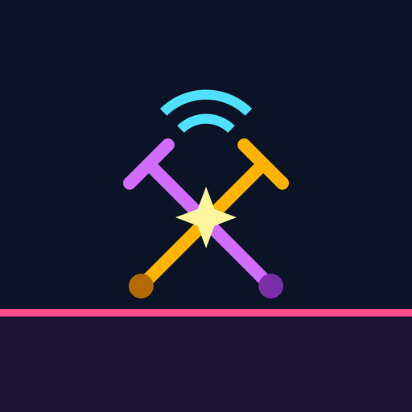

# Phonetic Hound Versus（開発中）

> **⚠ 開発中の版です。** CPU 戦・観戦・オンライン対戦を遊べますが、操作・バランス・画面は今後大きく変わります。
> オンライン対戦は**全員が同じ版**のときだけ遊べます（版が違う人の部屋には入れません）。

[Phonetic Hound](https://kijitora-no-hito.github.io/android-apps/phonetic_hound/) の世界のアンテナ使いたちが、光の壁に囲まれた闘技場で戦う、横画面の TPS 対戦ゲームです。
Android 版と Windows 版があり、**オンライン対戦では Android と Windows で一緒に遊べます**。

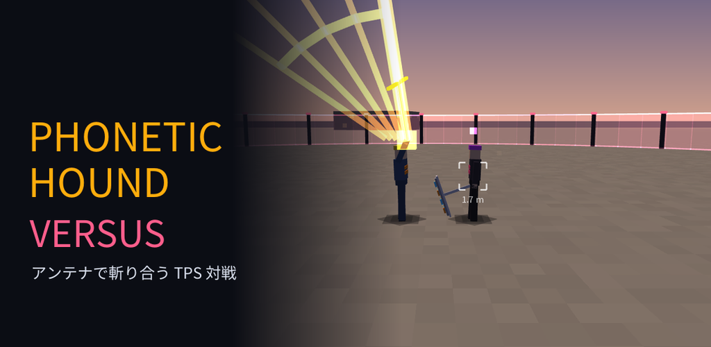

## どんなゲーム？

本家 Phonetic Hound の操作をもとに、人どうし・CPU と戦う対戦に作り直したゲームです。

- **1 対 1 〜 4 対 4**（人数は両チーム別々に 1〜4 人）。ルールは 基本（KO された人は抜ける）/ KO 回数（5 秒で復活）/ リーダー戦（冠をかぶったリーダーが倒れたら負け）。
- **CPU 戦**（強さ EASY / NORMAL / HARD × 型 近接寄り / 射撃寄り / バランス）と、CPU どうしの試合の**観戦**（速さ 0.5〜4 倍・カメラ 自動 / 肩越し / 自由）。
- **オンライン対戦**（部屋を作る / 番号で入る / 公開の部屋。Android と Windows の混ざった対戦。下の「オンライン対戦の遊び方」）。
- **近接 = 光の刃**: アンテナを剣のように大きく振りかぶって斬る。刃はチームの色に光り、長さ = 届く距離。各段で相手へ大きく踏み込み、連続技の最後の段でダウン。横に入れて押すと相手の背後へ**回り込み斬り**、疾走中に押すと滑りながら斬る。
- **遠距離**: アンテナから衝撃波の弾。**疾走中に押すと振り向きながら連射**。溜め完了で放すと、アンテナごとの範囲攻撃（全周の衝撃波・分散ビーム・光の柱・撃ちおろし・レーザーなど）。
- **疾走（8 方向）・ジャンプ / ジャンプキャンセル・空中疾走・回避**。闘技場のコンテナの上にも乗れる。
- **電波の噛み合い**: 相手の攻撃の出かかりに電波を合わせると、相手は**半ダウン** → 近くで近接を押すと**致命の一撃**。外すと隙が残る読み合い。
- **Lv 200 のセッティング**: 体力・近接・射撃・移動・疾走・スタミナ・回避に 200 ポイントを振り分ける（3 枠まで保存）。
- **アンテナ 8 種**（ダイポール・八木・バイコニカル・ホーン・パラボラ・フェーズドアレイ・ディッシュ・フライング）。リーチ・振りの速さ・段数・弾・溜め完了の攻撃が変わる。
- **キャラ 9 体**（ハウンドのほか、本家の敵のゾンビ・支配者・ボス・ロボット・ドローンなども選べる）。キャラは見た目だけで、性能はセッティングとアンテナで決まる。
- タッチ・ゲームパッド（DualShock 4 など）・キーボード（Windows 版）で遊べます。

<table>
<tr>
<td align="center">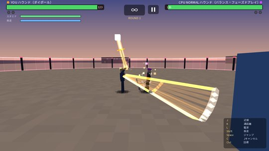 近接は光の刃。大きく振りかぶってから振り下ろす</td>
<td align="center">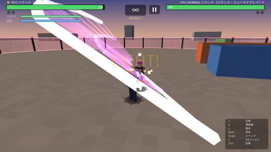 刃の長さ = 届く距離。振り抜くと残像が残る</td>
</tr>
<tr>
<td align="center">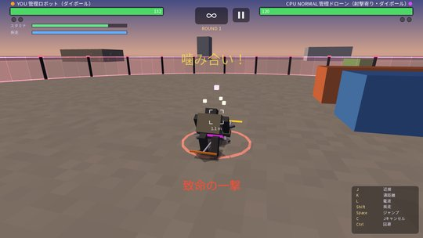 電波が噛み合うと半ダウン → 致命の一撃</td>
<td align="center">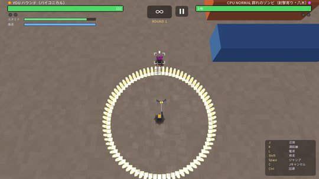 溜め完了の攻撃（バイコニカルは全周の衝撃波）</td>
</tr>
<tr>
<td align="center">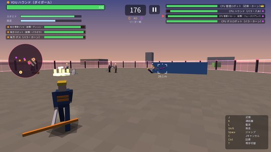 4 対 4 のリーダー戦。左はレーダー</td>
<td align="center">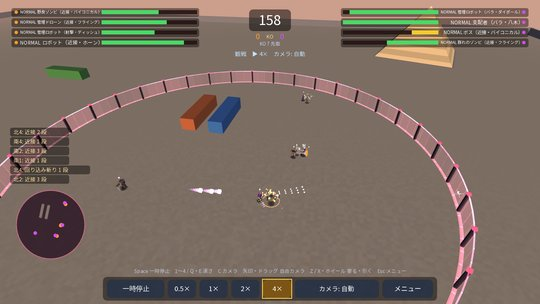 CPU どうしの 4 対 4 を観戦（4 倍速）</td>
</tr>
<tr>
<td align="center">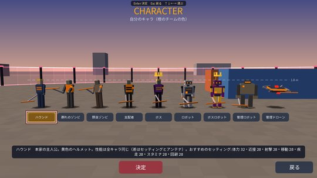 キャラは 9 体。みんな同じ背丈・同じ性能</td>
<td align="center">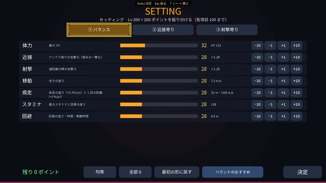 Lv 200 のポイントを振り分ける</td>
</tr>
<tr>
<td align="center">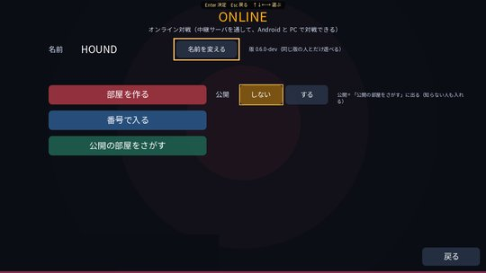 オンライン対戦: 部屋を作る / 番号で入る / 公開の部屋</td>
<td align="center">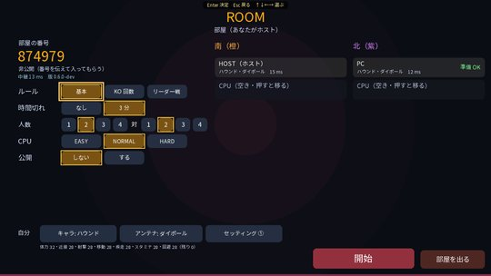 部屋: ホストがルール・人数を決める。空いた席は CPU</td>
</tr>
<tr>
<td align="center">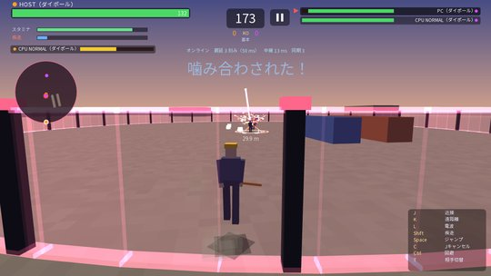 オンラインの 2 対 2（人 2 人 + CPU 2 人）</td>
<td align="center">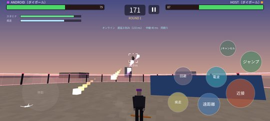 Android 版（タッチ）で Windows 版の相手と対戦</td>
</tr>
</table>

## ダウンロード

### [Android 版 APK をダウンロード（v0.6.2-dev・開発中・5.3 MB）](https://github.com/kijitora-no-hito/android-apps/releases/download/phonetichoundversus-v0.6.2-dev/phonetichoundversus-0.6.2-dev-release.apk)

### [Windows 版インストーラをダウンロード（v0.6.2-dev・開発中・27.2 MB）](https://github.com/kijitora-no-hito/android-apps/releases/download/phonetichoundversus-v0.6.2-dev/PhoneticHoundVersus-0.6.2-dev-setup.exe)

Windows 10 / 11（64 bit）用です。キーボード、ゲームパッドで遊べます（入れ方は下の「Windows 版」）。

 PC で見ている方へ: スマホでこの QR を読み取ると、このページが開きます。

## オンライン対戦の遊び方

タイトルの［オンライン対戦］から。初めてのときは名前（8 文字まで）を決めます。

- **全員が同じ版**を入れてください。版が違うと部屋に入れません（「版が違う部屋」と出ます）。新しい版が出たら、みんなで入れ直してください。
- **部屋を作る**: ［部屋を作る］で 6 桁の部屋番号が出ます。番号を友達に伝えて入ってもらいます。「公開」を［する］にすると、番号を知らない人も一覧から入れます。
- **番号で入る**: ［番号で入る］で、教えてもらった 6 桁の番号を入れます。
- **公開の部屋をさがす**: 公開の部屋の一覧から選んで入ります。
- 部屋を作った人（ホスト）が、ルール・時間切れ・人数（1〜4 対 1〜4）・CPU の強さを決めます。席を押すとそこへ移れます。ゲストが［準備 OK］にしたら、ホストが［開始］。
- **空いた席は CPU** が戦います。試合の途中で抜けた人の席も CPU が引き継ぎます。
- **ホストが抜けると部屋は閉じ、試合も終わります。**
- 1 部屋に入れる人は **6 人まで**です（4 対 4 の残りの席は CPU）。
- 試合中は一時停止できません（メニューを開いても試合は進みます）。
- Android 版と Windows 版の混ざった対戦ができます。通信が遅い・止まるときは、画面の真ん中に「通信待ち」と出ます。

## インストール方法

### Android 版

1. このページをスマホのブラウザで開き、上の「Android 版 APK をダウンロード」を押します。
2. ダウンロードした APK を開きます。初回は「提供元不明のアプリ」のインストールを許可するよう求められるので、使っているブラウザ（またはファイルアプリ）に許可してください。
3. Google Play プロテクトが警告を出すことがあります。ストアを通さない APK では一般的に出る表示です。心配なときは下の SHA-256 と一致するか確かめてください。

### Windows 版

1. 上の「Windows 版インストーラをダウンロード」で `PhoneticHoundVersus-0.6.2-dev-setup.exe` を保存して開き、案内に従って［次へ］→［インストール］。管理者の権限は要りません。
2. 「Windows によって PC が保護されました」と出たら **［詳細情報］→［実行］** を押してください（個人で配っているためコード署名をしていません）。
3. **更新**: ゲームを終わってから、新しい setup.exe を開くだけです。設定・セッティングはそのまま残ります。
4. **アンインストール**: Windows の「設定」→「アプリ」から。設定は残ります（消すかどうかも聞かれます。保存先は `%APPDATA%\PhoneticHoundVersus`）。

**動作環境**: Windows 10 / 11（64 bit）、OpenGL 2.1 以上のグラフィック、メモリ 4 GB 以上。Java は同梱しているので不要です。

| 操作 | キーボード |
| --- | --- |
| 移動 | WASD |
| 近接 / 遠距離（長押しで溜め） / 電波 | J / K / L |
| 疾走 / ジャンプ / ジャンプキャンセル | Shift / Space / C |
| 回避 | Ctrl |
| 狙いの切り替え（チーム戦） | T |
| ポーズ・メニュー | P / Esc |

ゲームパッド（DualShock 4 など）でも遊べます。

### 更新について

- 自動更新はありません。新しい版が出たら、このページから同じ手順で入れ直してください（上書きインストールになります）。
- Phonetic Hound・Phonetic Hound Defence とは別のアプリです。両方入れても、互いのセーブには影響しません。
- このアプリは GitHub でのみ配布しています。

## この版でできること（0.6.2-dev）

- CPU との対戦（1 対 1 〜 4 対 4・ルール 3 種・CPU の強さと型）、練習、CPU どうしの観戦。
- オンライン対戦（部屋を作る / 番号で入る / 公開の部屋・1 対 1 〜 4 対 4・人は 6 人まで・空いた席は CPU・Android と Windows の混ざった対戦）。
- 光の刃の近接（振りかぶり・踏み込み・回り込み斬り・ダッシュ近接）、遠距離（振り向き連射・アンテナ 8 種の溜め完了の攻撃）、電波の噛み合い → 半ダウン → 致命の一撃。
- 疾走（8 方向）・ジャンプ・ジャンプキャンセル・空中疾走・回避。
- Lv 200 のセッティング（3 枠）・アンテナ 8 種・キャラ 9 体。
- 起き上がり（0.5 秒）と近接の踏み込み・回り込みの間は無敵（攻撃ボタン・当たりが出た瞬間で解除。電波の噛み合いは通る）。
- オンラインの部屋で［観戦］（試合の途中からも見られる）。
- パッドのツインスティック操作（2 本のスティックで移動・開くとジャンプ・閉じるとジャンプキャンセル・L1 近接・R1 遠距離・同時押しで電波）。
- 練習・CPU 戦の準備でアンテナの動く見本、遊び方は 8 ページの図と動く見本。
- BGM と効果音（ケルト伝統曲をアプリ内のシンセサイザーで演奏）。

これから: バランスの調整、操作の見直し。

## 注意

- 開発中の版です。不具合があれば [Issues](https://github.com/kijitora-no-hito/android-apps/issues) へお知らせください。
- 戦闘の表現があります（流血の表現はありません）。

## 出典

- BGM の譜面: [The Session](https://thesession.org/)（ODbL 1.0）。Phonetic Hound と同じ譜面データを使っています
  （[music-data](https://github.com/kijitora-no-hito/android-apps/tree/main/phonetic_hound/music-data)）。
- フォント: Noto Sans JP（SIL Open Font License 1.1）
- ゲームエンジン: libGDX（Apache License 2.0）
- Windows 版: LWJGL（BSD）、GLFW・SDL2・tinyfd（zlib）、OpenAL Soft（LGPL）ほか、Java 実行環境（同梱）。ライセンス文はインストール先に同梱しています。

## プライバシーポリシー

[Phonetic Hound Versus プライバシーポリシー](https://kijitora-no-hito.github.io/android-apps/phonetic_hound_versus/privacy-policy.html)

---

| 項目 | 内容 |
| --- | --- |
| バージョン | 0.6.2-dev（2026-11-08・開発中） |
| ファイル（Android 版） | `phonetichoundversus-0.6.2-dev-release.apk`（5,556,457 バイト） |
| SHA-256（Android 版） | `961BBF1ED9E7C58CA864319D44D9A39CE342B267913BD674A3FA06BDC8481018` |
| 対応 Android | 7.0 以上（横画面） |
| ファイル（Windows 版） | `PhoneticHoundVersus-0.6.2-dev-setup.exe`（28,563,227 バイト） |
| SHA-256（Windows 版） | `A423664E8F2068AF81ECE855F65B114F277345399BF99ED639A15D4672C3327B` |
| 対応 Windows | 10 / 11（64 bit） |
| 価格 | 無料・広告なし・アプリ内課金なし・アカウント登録なし |

使う権限はインターネットだけです（オンライン対戦の中継のため）。タイトルの［オンライン対戦］を使ったときだけ作者の中継サーバ（taisen-game.com）に接続し、名前・選んだキャラとアンテナとセッティング・部屋の設定・試合中の操作の入力・アプリの版などを、同じ部屋の相手の端末へ送ります（中継サーバは中身を保存しません。部屋を公開したときだけ、ホストの名前と部屋の様子が公開の部屋の一覧に出ます。詳しくはプライバシーポリシーの「オンライン対戦」）。それ以外のときは通信しません。位置情報・端末の識別子は送りません。

---

[← アプリ一覧に戻る](../)
